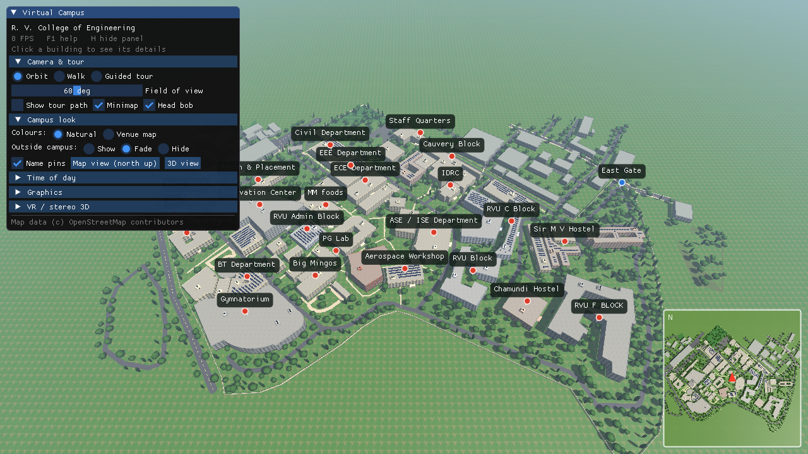

# Virtual Campus: CGVR Project

An interactive 3D model of **R. V. College of Engineering, Bengaluru**, built from OpenStreetMap data in
**C++ and OpenGL 3.3**. You can fly over the campus, walk through it, take a guided fly-through tour,
change the time of day, and see it all in VR: with red/cyan 3D glasses, or with **your own phone as
the VR headset** (head tracking, no app needed).



## Features

| Area | What it does |
|---|---|
| Campus | 91 buildings extruded from their real OSM footprints (heights from floor counts, courtyards as real holes), roads, footpaths, lawns, about 900 trees, compound wall with gates, name pins over departments and gates |
| Buildings | Weathered concrete roofs with parapets, stair/lift headrooms with black water tanks, south-facing solar panels on big roofs, entrance porches, window sunshades, darker plinths, lit windows at night, optional photo textures |
| Cameras | Orbit (bird's-eye), Walk (first person, collision with walls and trees, head bob), Guided tour (Catmull-Rom fly-through of 12 buildings with captions) |
| Rendering | Blinn-Phong lighting, Flat/Gouraud/Phong switch, procedural textures with mip-mapping, shadow mapping with PCF, procedural sky (sun, moon, stars, clouds), day/night cycle, fog, 4x MSAA, gamma correction |
| Interaction | Hover/click picking of buildings (name, type, height, floors, area, Fly here / Walk here), minimap (click to jump), Venue-map colour style, north-up map view, screenshots |
| VR | Off-axis stereo cameras; **Anaglyph** (red/cyan glasses, Dubois matrices); **Cardboard** (lens distortion); **Phone VR**: the phone's motion sensors steer the view (head tracking incl. head tilt) and the 3D image is streamed to the phone; comfort vignette and snap turn |

## Quick start (Windows, MSYS2 UCRT64 terminal)

```
cd /c/projects/VirtualCampus/VirtualCampus
rm -rf build
cmake -S . -B build -G Ninja
cmake --build build
./build/VirtualCampus.exe
```
The first `cmake` needs internet (it downloads GLFW, GLM, Dear ImGui, stb and nlohmann/json). GLAD is included.

**No compiler on the lab PC?** `windows-prebuilt/VirtualCampus.exe` is a ready-made build (static, no DLLs needed).
Keep it inside this folder so it can find `assets/`, and double-click it. It was cross-compiled and has not been
tested on a real Windows PC. If it doesn't start, build from source as above.

**Linux:** `sudo apt install build-essential cmake libx11-dev libxrandr-dev libxinerama-dev libxcursor-dev libxi-dev libgl-dev`,
then the same cmake commands.

## Controls

| Key / mouse | Action |
|---|---|
| **C** | Orbit <-> Walk camera |
| **T** | Start / stop the guided tour |
| **V** | Cycle VR modes: off, anaglyph, Cardboard |
| **Q / E** | Snap turn 30 degrees (in VR, walk mode) |
| **M** | Minimap on/off (click the minimap to jump there) |
| **H** | Hide / show the panel |
| **F1** | Help window |
| **F11** | Fullscreen |
| **F12** | Save `screenshot_N.png` |
| **Esc** | Stop the tour, then release the mouse, then quit |
| Orbit | Right-drag rotate, scroll zoom, WASD pan |
| Walk | Click to capture the mouse, mouse look, WASD, Shift run, Tab free mouse |
| Left-click | Select a building |

## VR modes

* **Anaglyph** (V once): wear red/cyan 3D glasses (red on the left eye). Works on any monitor or projector.
* **Cardboard** (V twice): left and right eye images, pre-distorted for the lenses of a phone VR viewer.
* **Phone VR**: the Cardboard image on your phone, with head tracking. Steps below.

### Phone VR (your phone as the headset)

1. PC and phone on the **same Wi-Fi** (a phone hotspot that the PC joins also works).
2. In the panel open **VR / stereo 3D** and press **Start phone VR**. The panel shows an address such as
   `http://192.168.1.5:8080`. If Windows asks whether to allow network access, allow it on *Private networks*.
3. Open that address in **Chrome on the phone**, press **Start VR**, turn the phone sideways and put it in a
   Cardboard viewer (or just hold it close).
4. Turn your head to look around. **Touch and hold** the screen to walk where you look; **double-tap** to re-centre.

**Head tracking needs one Chrome setting.** Chrome only gives motion sensors to secure (https) pages, and this
page is plain http on your own network. Once, on the phone: open
`chrome://flags/#unsafely-treat-insecure-origin-as-secure`, type the address shown on the PC
(for example `http://192.168.1.5:8080`), set it to **Enabled** and tap **Relaunch**. The phone page shows these
steps itself when it needs them. Without the setting you can still drag on the phone screen to look around.
(Alternative with a USB cable: `adb reverse tcp:8080 tcp:8080`, then open `http://localhost:8080`, which Chrome
treats as secure.)

How it works: the PC runs a small web server (`src/PhoneVR.h`). The phone sends its orientation 30 times a second;
the PC turns it into the camera's forward and up vectors (so tilting your head also tilts the view), renders both
eyes with lens distortion, and streams the frames back to the phone as Motion JPEG.

## Demo script (about 5 minutes)

1. **Overview**: the pins show the departments and gates. In *Campus look*, switch to **Venue map** colours and press
   **Map view (north up)**. Click a building to get its card, then **Fly here** or **Walk here**.
2. **Graphics**: open *Time of day* and drag the hour from 6 to 20 (moving shadows, sunset, lit windows, stars).
   In *Graphics*, toggle Shadows, Soft shadows, Textures and Flat/Gouraud/Phong. Zoom onto a roof: headrooms,
   water tanks, solar panels.
3. **Walk**: press **C**, click, and walk between buildings with WASD; you can't walk through walls or trees.
4. **Tour**: press **T** for the fly-through with building captions; tick *Show tour path* to see the spline.
5. **VR**: press **V** for the anaglyph (red/cyan glasses). Then **Start phone VR** and walk around with the phone.

## How it works (files)

```
src/main.cpp        app loop, input, render passes (shadow -> scene/eyes -> phone -> minimap -> UI), panel
src/Camera.h        orbit / walk / tour camera: view (lookAt) and projection matrices, head tracking
src/Mesh.h          VAO/VBO wrapper, MeshBuilder (winding fixed from normals), cube & plane
src/Shader.h        GLSL compile / link / uniforms
src/Geometry.h      shoelace area, point-in-polygon (ray casting), ear-clipping triangulation with holes
src/Campus.h        campus.json loader, building extrusion and rooftop details, roads, gates, compound wall,
                    trees (instancing), collision, ray-cast picking
src/Textures.h      procedural textures (value noise + fBm), PNG override, mip-mapping, anisotropy
src/Stereo.h        off-axis stereo cameras, MSAA eye framebuffers, composite pass
src/PhoneVR.h       web server for phone VR: phone page, head orientation in, Motion JPEG video out
src/Tour.h          Catmull-Rom spline tour with arc-length parameterisation
assets/shaders/     scene.vert/frag, depth.vert/frag (shadows), sky.vert/frag, stereo.frag (VR composite)
assets/campus/      campus.json (generated from the map)
assets/textures/    optional PNG overrides, e.g. photos of RVCE walls (see README.txt there)
tools/              osm_to_campus.py: OpenStreetMap .osm -> campus.json
data/               rvce_map.osm (OpenStreetMap export)
screenshots/        images for the report
```

### Render pipeline per frame
1. **Shadow pass**: buildings and trees rendered from the sun into a 4096² depth texture (orthographic projection).
2. **Scene pass**: sky (full-screen triangle, un-projected rays), then ground, lawns, paths, roads, buildings and
   instanced trees. In VR this runs **once per eye** into multisampled framebuffers, which `stereo.frag` combines
   (anaglyph colour matrices, or side-by-side with barrel distortion).
3. **Phone pass** (phone VR only): the finished image is read back (`glReadPixels`) and sent to the phone.
4. **Minimap pass**: the same scene from above with an orthographic projection, in a scissored corner viewport.
5. **UI pass**: Dear ImGui panel, name pins, labels.

## Syllabus topics shown

2D/3D transformations and composite matrices; viewing transformation (lookAt); perspective, orthographic and
off-axis projections; window-to-viewport mapping (minimap); clipping (scissor, near/far planes); hidden-surface
removal (z-buffer) and back-face culling; polygon triangulation (ear clipping) and inside-outside test; polygon
extrusion; Phong/Blinn-Phong illumination; flat, Gouraud and Phong shading; texture mapping, mip-mapping, filtering
and procedural noise textures; shadow mapping and PCF; render-to-texture (FBOs, MSAA resolve); instanced rendering;
Catmull-Rom curves and arc-length parameterisation; ray casting and picking (unprojection, ray-box slab test);
anti-aliasing; gamma correction; fog; **VR**: stereoscopy, binocular parallax, eye separation and convergence,
off-axis stereo, anaglyph, HMD lens distortion, head tracking (orientation from phone sensors, quaternions),
streaming to a head-mounted display, comfort (vignette, snap turn), navigation and presence.

## Using another campus

Export the area from openstreetmap.org (*Export*), then:
```
python tools/osm_to_campus.py map.osm assets/campus/campus.json --campus "Exact campus name in OSM"
```

## Attribution
Map data © OpenStreetMap contributors, Open Database Licence (ODbL).
Libraries: GLFW, GLM, Dear ImGui, stb_image / stb_image_write, nlohmann/json, GLAD.
